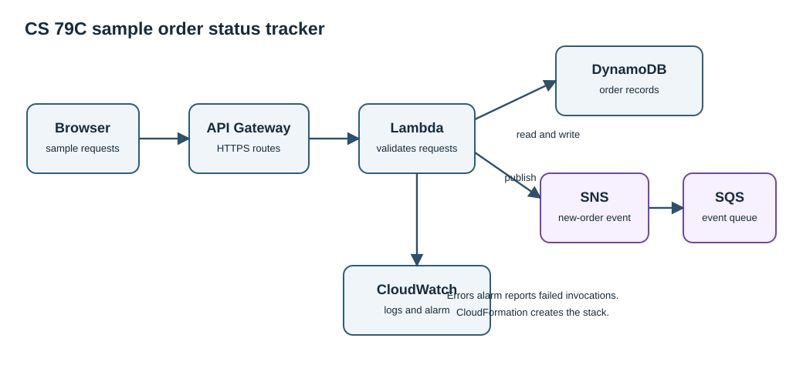

# Sample order status tracker

CS 79C final project by Daz Arnaud. This prototype stores sample orders and returns their status. It uses test data only. I deployed and tested the stack in AWS account 456157355074 in us-west-2 on October 25, 2026. The `evidence` folder contains console screenshots.



## AWS services

The CloudFormation template creates an API Gateway HTTP API, a Lambda function, a DynamoDB table, an SNS topic, an SQS queue, and CloudWatch logs and an error alarm. A browser sends an HTTPS request to the API. Lambda stores a sample order in DynamoDB and publishes an event. SNS delivers the event to SQS.

## API

POST /orders accepts JSON such as `{"itemName":"Sample notebook"}`. A successful request returns HTTP 201, an order ID, the status `received`, and the project name. GET /orders/{orderId} returns the saved order or HTTP 404. Empty names and invalid JSON return HTTP 400.

No payment details, addresses, or real customer data belong in this project.

## Reproduce the deployment

1. Sign in to an AWS account and choose us-west-2. Confirm a budget alert is active.
2. Open CloudFormation and create a stack from `template.yaml`. Name the stack `cs79c-final-project`. Acknowledge creation of the narrow Lambda execution role.
3. Wait for CREATE_COMPLETE. Copy `ApiBaseUrl` and `QueueUrl` from the Outputs tab.
4. Send a test POST request to `ApiBaseUrl/orders`. Copy the returned `orderId`.
5. Wait two seconds. Send a GET request to `ApiBaseUrl/orders/{orderId}` and confirm the status.
6. Open DynamoDB and confirm the sample item. Open SQS and poll the event queue. Open CloudWatch and confirm Lambda logs and the error alarm.
7. Capture screenshots of the running result and AWS resources. Keep the deployment brief. Delete the CloudFormation stack after proof.

The HTTP API is public while the stack runs. Do not use real data. The demo limits requests to one per second, with a burst of two. It does not include user authentication. Authentication would be required before broader use.

Example requests after deployment:

```sh
API_URL='paste-the-ApiBaseUrl-output-here'
curl -sS -X POST "$API_URL/orders" -H 'content-type: application/json' -d '{"itemName":"Sample notebook"}'
ORDER_ID='paste-the-returned-orderId-here'
curl -sS "$API_URL/orders/$ORDER_ID"
```

Use only the sample item name shown above. The responses include `Daz Arnaud, CS 79C Final Project` so the live result identifies the project.

## Local tests

Run `python3 -m unittest -v test_app.py` from this directory. The tests use fake AWS clients. They do not create cloud resources.

## Project files

`template.yaml` defines the deployable stack. `app.py` is a readable copy of the inline Lambda logic. `test_app.py` tests normal and invalid requests. `assets/architecture.svg` shows the data flow. `lab1/cs79c-stack.yaml` is the separate Module 8 Lab 1 template. The `evidence` folder holds AWS console screenshots from the deployment. `Arnaud-CS79C-Final-Project.pdf` is the project report.

## Cost and cleanup

DynamoDB uses on-demand billing. Lambda and API Gateway charge by requests and compute usage. SNS, SQS, and CloudWatch also have usage-based charges. The test used a few requests and a short deployment window. The [AWS Pricing Calculator estimate](assets/aws-pricing-estimate.pdf), exported October 25, 2026, is $0.11 per month for the stated low-usage assumptions in us-west-2. This is an estimate, not a bill. The account bill includes other work, so I do not assign its total to this project. Delete the stack after screenshots and tests.
